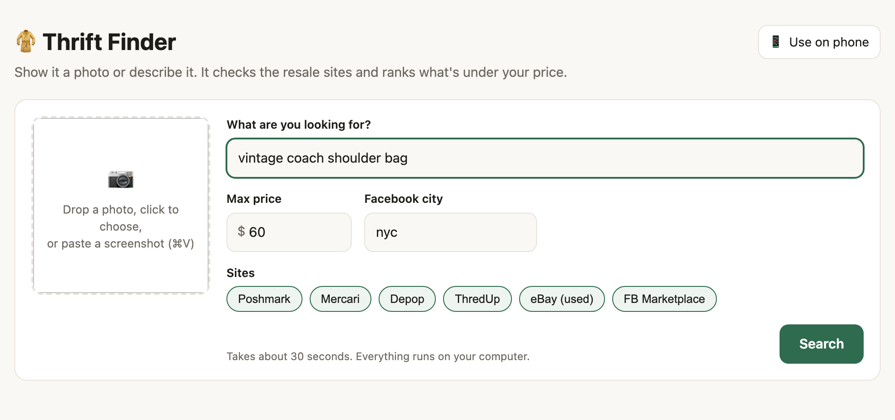
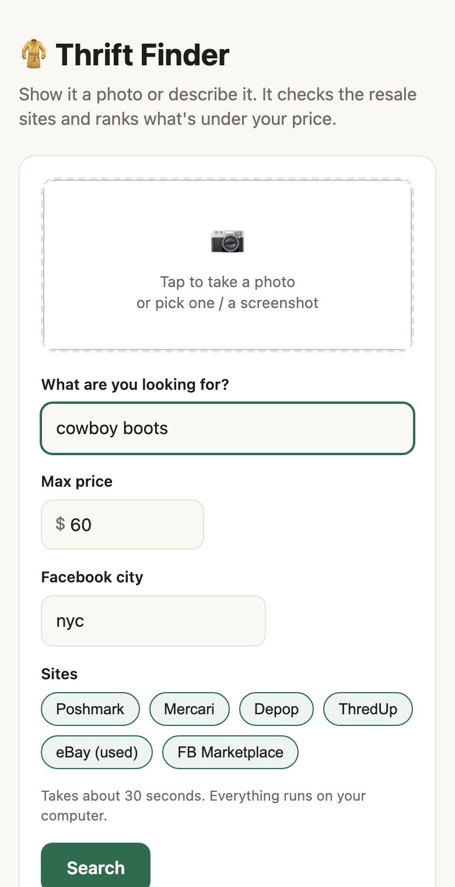

# 🧥 Thrift Finder

**Snap a photo (or type what you want), set a max price, and Thrift Finder searches
Poshmark, Mercari, Depop, ThredUp, eBay and Facebook Marketplace at once. It then
ranks everything by how closely it matches, including how much each listing's
photo looks like yours.**

Free and private: no accounts, no API keys, no paid services. It runs on your own
computer, and you can use it from your phone too.

<p align="center">
  
  &nbsp;
  
</p>

## Features

- **Search by photo:** drop in a picture or paste a screenshot of something you
  saw online. It works out what the item is and finds similar listings.
- **Six resale sites at once:** Poshmark, Mercari, Depop, ThredUp, eBay (used)
  and Facebook Marketplace, filtered to your price.
- **Visual ranking:** every listing photo is compared to yours, so the best
  matches come first even when sellers write vague titles.
- **Use it from your phone:** scan a QR code, add it to your home screen, and
  take photos while you're out.
- **Runs locally:** an AI image model runs on your computer. Nothing is uploaded
  anywhere except the searches themselves.

## Quick start

**1. Install the requirements** (both free):

- [Node.js](https://nodejs.org) version 22 or newer: pick the "LTS" download.
- [Google Chrome](https://www.google.com/chrome/): recommended. It gets better
  results than the backup browser that's installed otherwise.

**2. Download Thrift Finder.** Click the green **Code** button above →
**Download ZIP**, then unzip it. Or:

```bash
git clone https://github.com/<your-username>/thrift-finder.git
```

**3. Start it.** Double-click the launcher for your computer:

| | To use on this computer | To use from your phone too |
| --- | --- | --- |
| **Mac** | `Start Thrift Finder.command` | `Start Thrift Finder for phone.command` |
| **Windows** | `Start Thrift Finder.bat` | `Start Thrift Finder for phone.bat` |

The first launch sets everything up. That takes a few minutes and downloads about
300 MB. After that it opens straight to **http://localhost:4747** in your browser.
Keep the window it opens running while you use the app, and close it to quit.

<details>
<summary><b>Mac says the launcher "can't be opened"?</b></summary>

macOS blocks scripts downloaded from the internet the first time. Either:

- Right-click the file → **Open** → **Open**, or
- Try to open it once, then go to **System Settings → Privacy & Security**, scroll
  down and click **Open Anyway**.

You only need to do this once. You can also skip the launcher and use the
terminal (below).
</details>

<details>
<summary><b>Prefer the terminal?</b> (any OS, including Linux)</summary>

```bash
cd thrift-finder
npm run setup     # once
npm start         # use on this computer
npm run phone     # ...or use from your phone too
```
</details>

## How to use it

1. **Add a photo:** drag it onto the box, click to pick a file, or paste a
   screenshot (⌘V / Ctrl+V). **Or** just type what you want, e.g.
   *vintage coach shoulder bag*.
2. With a photo, use the text box for anything the photo can't show, like a brand
   or size: *levis, size M*.
3. Set your **max price**, choose which sites to search, and press **Search**.
   It takes about 30 seconds.
4. The best matches come first. You can sort by price, hide a site, or use
   **See more on** to open the full search on any site.

Your max price, sites and Facebook city are remembered for next time.

> **Facebook city:** Marketplace searches one area at a time. Use the city name
> from a Marketplace link, e.g. `nyc`, `la`, `chicago`, `sanfrancisco`. Open
> Marketplace, set your location, and copy the word after `/marketplace/` in the
> address bar.

## Use it on your phone

Your computer does the searching; your phone is the remote. This is free, and it
works better than cloud hosting because resale sites trust home internet
connections far more than cloud servers.

1. Start with the **for phone** launcher (or `npm run phone`). If your computer
   asks whether to allow incoming connections, click **Allow**.
2. Scan the QR code with your phone's camera and tap the link. The code is shown
   in the launcher window, or click **📱 Use on phone** in the app on your
   computer.
3. Optional: add it to your home screen. On iPhone: **Share → Add to Home
   Screen**. On Android: **⋮ → Add to Home screen**.

On the phone, tap the photo box to take a picture or choose a screenshot.

- **The link is private.** Only devices that opened it can use the app; anyone
  else on your Wi-Fi sees a "private link needed" page. To sign out every phone,
  restart with `node server.js --phone --reset-key` and scan the new code.
- **Keep the computer on.** On a Mac, the phone launcher stops it from going to
  sleep on its own while it runs. Closing a laptop lid still puts it to sleep.

### Away from home

Use [Tailscale](https://tailscale.com), a free private network between your own
devices. Nothing is exposed to the public internet.

1. Install Tailscale on your computer and on your phone, and sign in to both with
   the same account.
2. Restart Thrift Finder with the **for phone** launcher. A second QR code
   labelled **Anywhere (Tailscale)** appears. Scan that one.

It then works over mobile data anywhere, as long as your computer is on and online.

## Better results from photos (optional)

The built-in image model gets the item type and color right, but it can't read
brands or logos. For sharper searches (e.g. *Levi's black trucker jacket* instead
of *black denim jacket*), you can add a free Google Gemini key:

1. Get a key at [aistudio.google.com/apikey](https://aistudio.google.com/apikey).
2. Set it before starting Thrift Finder:
   - **Mac / Linux:** `export GEMINI_API_KEY=your-key` (add it to `~/.zshrc` to
     keep it)
   - **Windows:** `setx GEMINI_API_KEY your-key`, then open a new window

Gemini is only used to turn your photo into search words; ranking still runs on
your computer. If the key is missing or the call fails, the built-in model is used.

## Command line

Everything the app does also works from a terminal:

```bash
node find.js "vintage coach shoulder bag" --max 60
node find.js --image ~/Downloads/jacket.jpg --max 30 --hint "levis"
node find.js "mid century lamp" --max 80 --sites facebook,ebay,mercari --fb-city chicago
```

It prints the top matches and saves a results page plus JSON in `results/`.
Run `node find.js --help` for every option.

## How it works

```
photo ─► image model (item type, material) + pixel color ─► search words ─┐
text  ─────────────────────────────────────────────────────────────────────┤
                                                                           ▼
        Chrome opens each site's search with your max price (window kept off-screen)
                                                                           ▼
        a generic reader pulls title, price and photo from every listing
                                                                           ▼
        drop anything over your price; score = title match + photo similarity
                                                                           ▼
                                                  ranked results
```

- **Image model:** [CLIP](https://openai.com/research/clip) (ViT-B/32) running
  locally through [Transformers.js](https://huggingface.co/docs/transformers.js).
  It's downloaded once (~150 MB) and cached.
- **Browser:** [Playwright](https://playwright.dev) drives a normal Chrome window
  moved off-screen. eBay and ThredUp block hidden ("headless") browsers.
- **Listing reader:** finds listing links and reads each card's title, price and
  photo without relying on site-specific CSS classes, so most redesigns don't
  break it.

| File | What it does |
| --- | --- |
| `server.js`, `public/index.html` | The web app |
| `find.js` | Command-line version |
| `setup.js` | One-time setup: checks Node, finds a browser, downloads the model |
| `src/agent.js` | The pipeline: photo/text → search words → search → rank |
| `src/sites.js` | Search address and listing pattern per site. **Add new sites here.** |
| `src/scrape.js` | Browser control and the listing reader |
| `src/vision.js` | Image model: photo → search words, image similarity, optional Gemini |
| `src/rank.js` | Scoring |
| `src/phone.js` | Phone access: private link, QR codes |
| `src/platform.js` | macOS / Windows / Linux helpers |

## Troubleshooting

- **A site shows "failed" or finds 0 listings.** Sites change their pages from
  time to time. Click **See more on** to check the site still loads, then compare
  its search address with `src/sites.js`. Issues and pull requests are welcome.
- **"Port already in use".** Thrift Finder is probably already running; look for
  its window. To use a different port: `PORT=5000 npm start`.
- **Phone can't open the link.** Make sure the phone is on the same Wi-Fi (not
  mobile data, unless you use Tailscale) and that you allowed incoming
  connections. Some guest or office networks block devices from seeing each other.
- **Linux: the browser won't start.** Install its system libraries with
  `npx playwright install --with-deps chromium`. A desktop session is needed,
  since the browser runs as a normal window.
- **Start over.** Delete the `node_modules` folder and run the launcher again.
  Saved browser data and the phone key live in `~/.thrift-finder/`.

## Limitations

- Only the first page of results from each site is read (about 25–100 listings
  per site).
- Facebook Marketplace is searched while logged out, so you see the public
  results for one city.
- ThredUp mostly sells women's and kids' clothing.
- One search runs at a time.

## Responsible use

Thrift Finder is a personal shopping tool. It's not affiliated with or endorsed by
any of the sites it searches. It loads the same public search pages you'd see in
your browser, one search at a time. Please keep it that way: don't use it for
bulk scraping or reselling data, and respect each site's terms of service. In
particular, Meta's terms prohibit automated access to Facebook. Leave
Marketplace unchecked if you'd rather not include it.

## License

[MIT](LICENSE)
